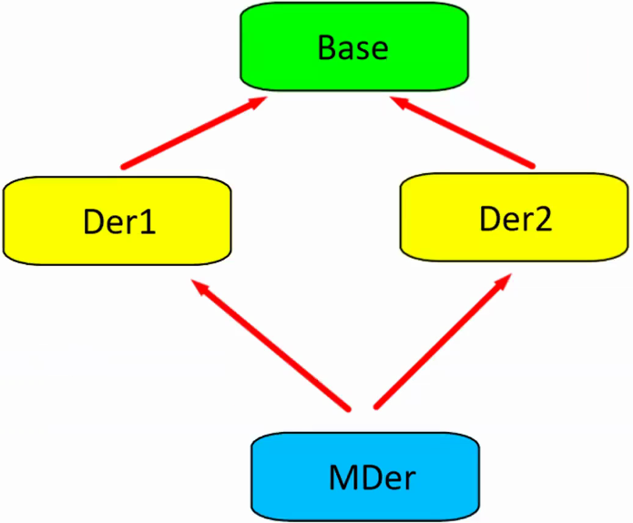

# LECTURE 23

## How Do Compilers Implement the Virtual Dispatch Mechanism

When a polymorphic class is defined, compiler creates an array with it's elements pointing to it's
virtual functions. This array is called `Virtual Function Table Pointer`, commonly shortened to
`Virtual Pointer` or `vpointer`.

- This pointer is initialized during runtime.
- Vpointer of a class will be shared among instances.
- Vpointer of a derived class will point to the corresponding function of the derived class.

```cpp
struct ICar {
    virtual void start();
    virtual void stop();
}; // struct ICar

struct Audi : public ICar {
    void start() override {}
    void stop() override {}
}; // struct Audi
```

Vpointer of `ICar` class will have the pointers to the `ICar::start()` and `ICar::stop()` functions.  
Vpointer of `Audi` class will have the pointers to the `Audi::start()` and `Audi::stop()` functions.

##### ###REMARK###

> These two vpointers will have something in common, the order of the elements. The function being
> pointed by the pointer with 0 index of the table will be pointing to the same respective function
> from each class.

##### ###REMARK###

> There is a way to access the vpointer of the class. Since it is a pointer, it can be used to
> invoke calls to the member functions. Order of the elements are decided by the declaration order
> of the Base class.
>
> ```cpp
> Audi a1;
> void** vptr_a1 = *(void***)&a1;
> ((void (*)(car::Audi*))vptr_a1[0])(&a1); // this will call the funtion at the 0 index.
> ```

## `final` Keyword

Can be used in two different ways.

1. final class  
    Prevents the class being used as a parent class in inheritence.

    ```cpp
    struct Base {};

    struct Der final : public Base {};

    struct Dez : public Der {}; // INVALID. Der is a final class, cannot be inherited from.

    struct Random final {}; // VALID Can also be used in this way.
    ```

2. final override  
    Prevents the member function of a base class being overridden by a derived class.

```cpp
struct Base {
    virtual void foo();
    virtual void bar() final;
}; // struct Base

struct Der : public Base {
    void foo() override; // VALID
    void bar() override; // INVALID
}; // struct Der
```

## `private` Inheritance

In `public` inheritance, the public interface of the base class is inherited to the public interface
of the derived class, same for the protected interface. In `private` inheritance, they are inherited
to the private interface of the derived class.  
There are some important properties of `private` inheritance

1. Since the is-a relationship is not directly possible, upcasting is only possible in a member
    function of the derived class, or in a `friend` functions of the derived class.

    ```cpp
    class Base {}; // class Base

    class Der : private Base {
        void foo() {
            Der myder;
            Base* baseptr = &myder; // VALID
            Base& baseref = myder;  // VALID
        }

        friend void bar() {
            Der myder;
            Base* baseptr = &myder; // VALID
            Base& baseref = myder;  // VALID
        }
    }; // class Der

    int main() {
        Der myder;
        Base* baseptr = &myder; // INVALID
        Base& baseref = myder;  // INVALID
    }
    ```

2. `private` inheritance does not exactly represent a is-a relationship like `public` inheritance but,
there still exists a base `class` inside the derived `class`. So, `private` inheritance is more
similar to containment.

    ```cpp
    class Base {
    public:
        void foo();
    }; // class Base

    class Der : private Base {
    public:
        void func() {
            foo();
        }
    }; // class Der
    ```

### Comparison of Containment and `private` Inheritance

```cpp
class Base {
protected:
    void pro();

public:
    virtual void vf();
    void foo();
    void bar();
}; // class Base

class Der : private Base {
public:
    using Base::bar;

    void vf() override; // VALID, #4

    void func() {
        foo(); // VALID
        pro(); // VALID, #3
    }
}; // class Der

class Myclass {
public:
    void vf() override; // INVALID, #4

    void func() {
        foo(); // VALID
        pro(); // INVALID, #3
    }

private:
    Base _b;
}; // class Myclass
```

1. With `private` inheritance not every Der is a Base but some may be. With containment, no Myclass
    can be a Base.
2. With containment, Myclass can have multiple instances of Base, but with `private` inheritance
    there can only be one.
3. If Base has a `protected` section, Der can access it but Myclass cannot.
4. If Base has `virtual` functions, Der can have overriding member functions but Myclass cannot.

### Reasons to Choose `private` Inheritance over Containment

1. To access the `protected` members of the base `class`.
2. To `override` the `virtual` member functions of the base `class`.
3. Because an abstract `class` cannot be instantiated, therefore cannot be used as a member of a
    `class`.
4. To have restricted polymorphism.
5. To have the advantages of Empty Base Optimization (EBO).

### Empty Base Optiomization (EBO)

When an empty class used as a member, storage needs are increased. With `private` inheritance this
does not happen.

```cpp
class Base {};

class Der : private Base {
    int _x;
}; // class Der

class Myclass {
    int _x;
    Base _y;
}; // class Myclass
```

Depending on the system and compiler settings, size of these `class`es may vary, but Myclass will
have a higher storage need then Der. This extra need for storage happens due to alignment rules.

### Restricted Polymorphism

This is the idiom of having only selected functions to have upcasting for the derived `class`.

```cpp
class Base {}; // class Base

class Der : private Base {
    friend void foo(Base&) {
        Der myder;
        Base& baseref = myder; // VALID
    }
}; // class Der

void bar(Base&);
void baz(Base&);

int main() {
    Der myder;

    foo(myder); // INVALID
    bar(myder); // INVALID
    baz(myder); // INVALID
}
```

## `protected` Inheritance

The logic for use of `protected` Inheritance is exactly the same except instead of adding the
inherited members to the `private` interface of the derived `class`, they are added to the
`protected` interface of the derived `class`. This is usually used in multi-level inheritance.

```cpp
class Base {
protected:
    void foo();
}; // class Base

class Der : protected Base {
    void bar() {
        foo();
    }
}; // class Der

class Dez : public Der {
    void baz() {
        foo();          // If Der were to be privately inherited, this line would be INVALID.
    }
}; // class Dez
```

## Multiple Inheritance

```cpp
class BaseX {
public:
    void Xfoo();
    void Xbar();

    virtual void foo();
}; // class BaseX

class BaseY {
public:
    void Yfoo();
    void Ybar();

    virtual void bar();
}; // class BaseY

class BaseZ {
public:
    void Zfoo();
    void Zbar();
}; // class BaseZ

class BaseT {
public:
    void Tfoo();
    void Tbar();
}; // class BaseT

class Der : public BaseX, public BaseY, private BaseZ, protected BaseT {
public:
    void foo() override;    // VALID since Der inherits all the above classes.
    void bar() override;    // VALID since Der inherits all the above classes.
};

int main() {
    Der myder;

    myder.Xfoo();   // VALID
    myder.Xbar();   // VALID
    myder.Yfoo();   // VALID
    myder.Ybar();   // VALID
    myder.Zfoo();   // INVALID
    myder.Zbar();   // INVALID
    myder.Tfoo();   // INVALID
    myder.Tbar();   // INVALID
}
```

One of the most important things in Multiple Inheritance is name collision.

```cpp
class A {
public:
    void foo(int) {}
}; // class A

class B {
public:
    void foo(double) {}
}; // class B

class C : public A, public B {
    void func() {
        foo();  // AMBIGIOUS. When multiple inheritence is used, name look-up happens simultaneously
                // on all classes involved. Because there are 2 valid functions for this call, it
                // causes ambiguity.
        A::foo(12);     // VALID
        B::foo(1.2);    // VALID
    }
}; // class C

int main() {
    C cx;

    cx.foo(12); // Again ambigious.
    cx.A::foo(12);  // VALID
    reinterpret_cast<A*>(&cx)->foo(12); // VALID
    cx.B::foo(1.2); // VALID
    reinterpret_cast<B*>(&cx)->foo(1.2); // VALID
}
```

```cpp
class A {
public:
    void foo(int) {}
}; // class A

class B {
public:
    void foo(double) {}
}; // class B

class C : public A, public B {
public:
    using A::foo;
    using B::foo;
}; // class C

int main() {
    C cx;

    cx.foo(12);     // VALID, will call A::foo(int)
    cx.foo(1.2);    // VALID, will call B::foo(double)
}
```

```cpp
class A {
public:
    A() {
        std::cout << "A ctor\n";
    }
}; // class A

class B {
public: 
    B() {
        std::cout << "B ctor\n";
    }
}; // class B

class C : public A, public B {}; // class C

int main() {
    C cx;
}
```

The above piece of code will output
> A ctor
> B ctor

This is because the initialization of the inherited classes are defined by the inheritence order.

### Diamond Formation (sometimes called Dreadful (or Deathful) Diamond of Derivation (DDD))

```cpp
class Base {
public:
    void foo() {}
}; // class Base

class Der1 : public Base {}; // class Der1

class Der2 : public Base {}; // class Der2

class MDer : public Der1, public Der2 {
    void func() {
        foo();  // AMBIGIOUS because compiler cannot decide with which "this" to use to call foo.
                // "this" of Base in Der1 or "this" of Base in Der2.
        Der1::foo();    // VALID
        Der2::foo();    // VALID
    }
}; // class MDer

void func(Base&) {}

int main() {
    MDer md;

    md.foo();   // Again ambigious.
    md.Der1::foo(); // VALID
    md.Der2::foo(); // VALID

    func(md);   // Again ambigious for the same reason. Compiler cannot decide wich Base object that
                // is present inside md to pass.
    func(static_cast<Der1&>(md)); // VALID
    func(static_cast<Der2&>(md)); // VALID
}
```



Because both Der1 and Der2 have a Base object inside, MDer will have 2 Base objects, one inside
Der1 and one inside Der2.

### Virtual Inheritance

It is used to force compiler to create one and only one Base class in Diamond Formation scenarios.

```cpp
class Base {
public:
    void foo() {
        std::cout << "foo()\n";
    }
}; // class Base

class Der1 : virtual public Base {}; // class Der1

class Der2 : virtual public Base {}; // class Der2

class MDer : public Der1, public Der2 {
    void func() {
        foo();          // not ambigious anymore, because there is onle one Base object in MDer.
        Der1::foo();    // INVALID
        Der2::foo();    // INVALID
    }
}; // class MDer

void func(Base&) {}

int main() {
    MDer md;

    md.foo();       // VALID
    md.Der1::foo(); // INVALID
    md.Der2::foo(); // INVALID

    func(md);                       // VALID
    func(static_cast<Der1&>(md));   // INVALID
    func(static_cast<Der2&>(md));   // INVALID
}
```

Virtual inheritance requires the base class to be constructed, even if the base class is not
directly inherited.

```cpp
class Base {
public:
    Base(char const* c) { std::cout << "Base(char const* c), c = " << c << '\n'; }
}; // class Base

class Der1 : virtual public Base {
public:
    Der1() : Base("Der1") {}
}; // class Der1

class Der2 : virtual public Base {
public:
    Der2() : Base("Der2") {}
}; // class Der2

class MDer
: public Der1
, public Der2 {
public:
    MDer() : Base("MDer") {}
}; // class MDer

class MDez : public MDer {
public:
    MDez() : Base("MDez") {}
}; // class MDez

int main() {
    MDer myder;
    MDez mydez;
}
```

The above code snippet will have the following output
> Base(char const* c), c = MDer  
> Base(char const* c), c = MDez
