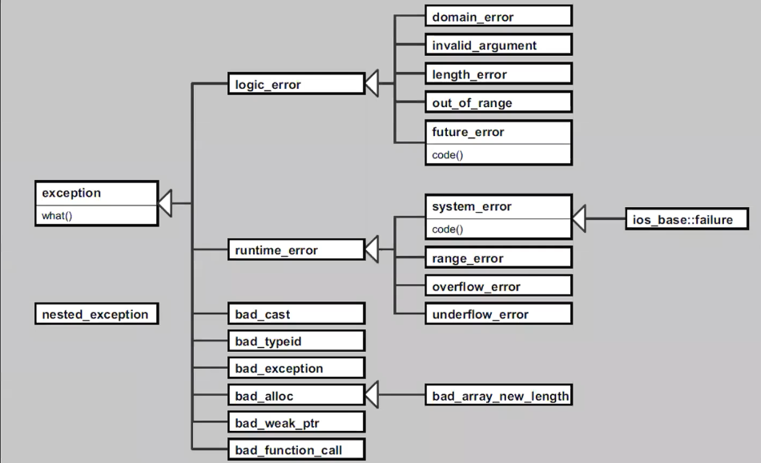

# LECTURE 24

## Exception Handling

Traditional way of handling errors rely on one of the following;

1. Return value of a function,  
   e.g.
   - `void* malloc(std::size_t size)`,
   - `std::FILE* fopen(const char* filename, const char* mode)`
2. Value of the out parameter of a function
3. Setting a global variable (see errno.h for further explanation on this)

Each of these methods have their own issues as well as one big common issue, they lack enforcement.
Meaning, if you were to use `malloc()` or `fopen()` you can skip checking the validity of the return
value. Same goes for checking the validity of the out parameter and checking the global error
variable.

### Problems Specific to Using Return Value of a Function

- Constructors and destructors don't have return values.
- In some cases, return value can be both an error and a valid value,  
  e.g.  
   `int atoi(char const* str)`, will return 0 for unsuccessful operations but, will also return 0
  if the value of the `str` is 0. In this case, we cannot determine whether the operation was
  successful or not if we rely only on the return value.

### `throw` Statement

Creates and throws an exception object. This object is not just a return value, it represents the
exception.

### `try` Block

This block basically tells the compiler that it is a candidate to receive throw statements.

```cpp
try {
    foo();
}
```

- This block will be a candidate for all throw statements happenning in `foo()` as well as the
  functions that are called by `foo()`.

### `catch` Block

This block contains the code that handles the exception that was thrown. Hence the alternative name
Exception Handler.

- After every `try` block, there must be at least one `catch` block.

```cpp
catch (int x) {
    //.. code goes here.
}
```

##### ###REMARK.129###

> `try-catch` mechanism should not be used like the traditional ways. This is worse than using the
> traditional ways of exception handling.  
> Also, as a general rule, if you have to ask "I've caught an exception, what should I do now?" then
> there is a high chance you should not have caught that exception, it wasn't yours to catch.

### Deeper Look into `throw` Statement

Can exist in two different ways;

- ```cpp
  throw; // Also called rethrow statement
  ```

  Rethrow statement is just rethrowing a previously caught throw statement.

- ```cpp
  throw expr;
  ```

##### ###REMARK.130###

> Both the C++ and STL has the following built-in exception classes.
> 

##### ###REMARK.131###

> When there is an uncaught exception, the `terminate()` from STL will be called and it will call
> `abort()` (again from STL). Why isn't `abort()` called directly? Because there is another function
> called `set_terminate()`, which modifies the behaviour of `terminate()`. So if wanted, calling of
> `abort()` can be avoided by using `set_terminate()`.

### Uncaught Exceptions

We will spend considerable amount of time on catching errors but first we start with Uncaught
Exceptions.

```cpp
#include <iostream>

#define st() (std::cout << __func__ << " started\n")
#define end() (std::cout << __func__ << " ended\n")

void f2() {
    st();
    end();
}

void f1() {
    st();
    f2();
    end();
}

int main() {
    st();
    f1();
    end();
}
```

Will have the following output

> main started  
> f1 started  
> f2 started  
> f2 ended  
> f1 ended  
> main ended

If there were to be `throw` statement in, let's say `f2()` between the `st()` and `end()` calls,

```cpp
void f2() {
    st();
    throw 1;
    end();  // because of the throw statement above, this statement is unreachable.
}
```

then the output would be the following

> main started  
> f1 started  
> f2 started  
> terminate called after throwing an instance of 'int'  
> Aborted (core dumped)

#### How to use `set_terminate()`

```cpp
#include <iostream>

#define st() (std::cout << __func__ << " started\n")
#define end() (std::cout << __func__ << " ended\n")

void myabort() {
    std::cout << "myabort called\n";
    std::exit(EXIT_FAILURE);
}

void f2() {
    st();
    throw 1;
    end();  // because of the throw statement above, this statement is unreachable.
}

void f1() {
    st();
    f2();
    end();
}

int main() {
    std::set_terminate(myabort);
    st();
    f1();
    end();
}
```

Will have the following output

> main started  
> f1 started  
> f2 started  
> myabort called

##### ###REMARK.132###

> Exception Safety is the state of code working correctly when exceptions are thrown. If the program
> has no uncaught exceptions, it is exception safe.

Exceptions can be handled in two general ways;

1. Terminative
   When an exception is thrown, the program terminates.

2. Resumptive
   When an exception is thrown, instead of terminating, the program continues in a defined way.

### Syntax of `try` and `catch` Blocks

```cpp
try {
    foo();
}
catch (int) {
    //.. code goes here
}
```

- In the parameter of `catch` blocks, implicit type conversion does not happen. There are two
  exceptions to this rule,
  - Upcasting (implicit conversion from derived class to base class)
  - Array decay
- The `catch` parameter does not require to be named. Unless the parameter is used in the `catch`
  block, naming the parameter should be avoided.
- `catch` parameters are almost exclusively reference types. This is done to prevent object slicing,
  and to use virtual dispatch. Having a reference type also prevents the unncessary call to copy
  constructor.
- Rules of `const` correctness also apply here.

```cpp
#include <iostream>

class ExceptionBase {
public:
    virtual char const* what() const { return "Error\n"; }
};

class MathException : public ExceptionBase {
public:
    char const* what() const override { return "MathError\n"; }
}; // cllass MathException

class DivideByZeroError : public MathException {
public:
    DivideByZeroError() { std::cout << "DivideByZeroError ctor() called\n"; }

    ~DivideByZeroError() { std::cout << "DivideByZeroError dtor() called\n"; }

    char const* what() const override { return "DivideByZeroError\n"; }
};

int divide(int const a, int const b) {
    if (b == 0) {
        throw DivideByZeroError{};
    }
    return a / b;
}

int main() {
    try {
        std::cout << divide(5, 2) << '\n';
        std::cout << divide(5, 0) << '\n';
    }
    catch (ExceptionBase const& exc) {
        std::cout << exc.what();
    }
}
```

Above code snippet will have the following output

> 2  
> DivideByZeroError ctor() called  
> DivideByZeroError  
> DivideByZeroError dtor() called

- There is a way to catch all exceptions without distinguishing the type.

  ```cpp
  catch (...) {
      //.. code goes here
  }
  ```

  This type of `catch` blocks are called catch-all block.

- Declaration order of `catch` blocks are important. Compiler tries to match the exception by going
  through that declaration order. As a rule of thumb, the `catch` blocks must be ordered from
  special to general. If a catch-all is to be used, it must be the last `catch` block.
- Throughout this course, the exception `class`es of the standard library will be inspected.
- Since both `try` and `catch` blocks are blocks, the rules of scope also apply to them.
- One `throw` statement could trigger a search in multiple `try` blocks, e.g.

  ```cpp
  #include <iostream>

  void f3() {
      try {
          throw 10;
      }
      catch (double const&) {
          std::cout << "Exception caught in f3(), catch(double const&)\n";
      }
  }

  void f2() {
      try {
          f3();
      }
      catch (float const&) {
          std::cout << "Exception caught in f2(), catch(float const&)\n";
      }
  }

  void f1() {
      try {
          f2();
      }
      catch (...) {
          std::cout << "Exception caught in f1(), catch(...)\n";
      }
  }

  int main() { f1(); }
  ```

  The above code snippet will have the output

  > Exception caught in f1(), catch(...)

### Stack Unwinding

`try`-`catch` guarantees the destruction of automatic lifetime instances. In the code snippet below,
if `f1()` were to be called without a `try`-`catch`, the `throw` statement in `f4()` would end up
calling `std::terminate()` and `std::abort()` and the program would terminate without releasing the
acquired resources. In short, `try`-`catch` guarantees the RAII.

```cpp
#include <iostream>

class Resource {
public:
    Resource(int val) : _x{val} { std::cout << "Resource acquired, _x = " << _x << '\n'; }

    ~Resource() { std::cout << "Resource released, _x = " << _x << '\n'; }

private:
    int _x;
};

void f4() {
    Resource r{4};
    throw 1;
}

void f3() {
    Resource r{3};
    f4();
}

void f2() {
    Resource r{2};
    f3();
}

void f1() {
    Resource r{1};
    f2();
}

int main() {
    try {
        f1();
    }
    catch (int const&) {
        std::cout << "Exception caught\n";
    }
    std::cout << "Main continues\n";
}
```

Above code snippet will have the following output

> Resource acquired, \_x = 1  
> Resource acquired, \_x = 2  
> Resource acquired, \_x = 3  
> Resource acquired, \_x = 4  
> Resource released, \_x = 4  
> Resource released, \_x = 3  
> Resource released, \_x = 2  
> Resource released, \_x = 1  
> Exception caught  
> Main continues

Without a `try`-`catch` block it would have the following output

> Resource acquired, \_x = 1  
> Resource acquired, \_x = 2  
> Resource acquired, \_x = 3  
> Resource acquired, \_x = 4  
> terminate called after throwing an instance of 'int'  
> Aborted (core dumped)

##### ###REMARK.133###

> `try`-`catch` guarantees the destruction of automatic lifetime instances but not dynamically
> created objects. When an exception occurs, this must be kept in mind on deciding how the program
> should contiunue.
